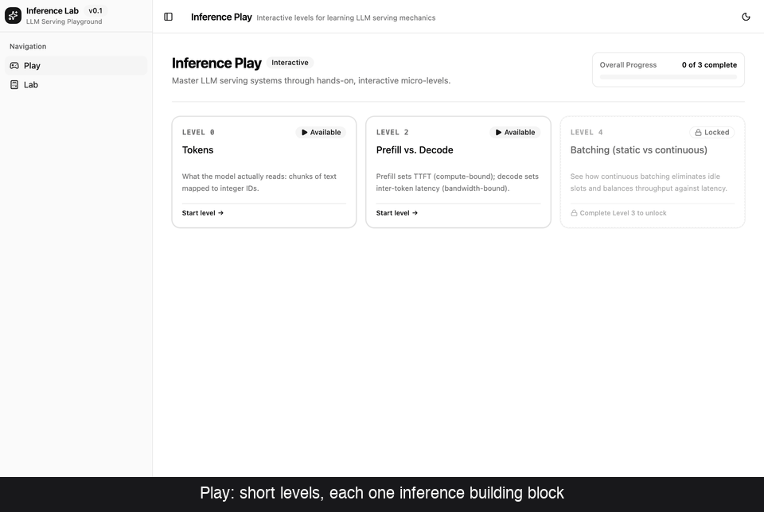
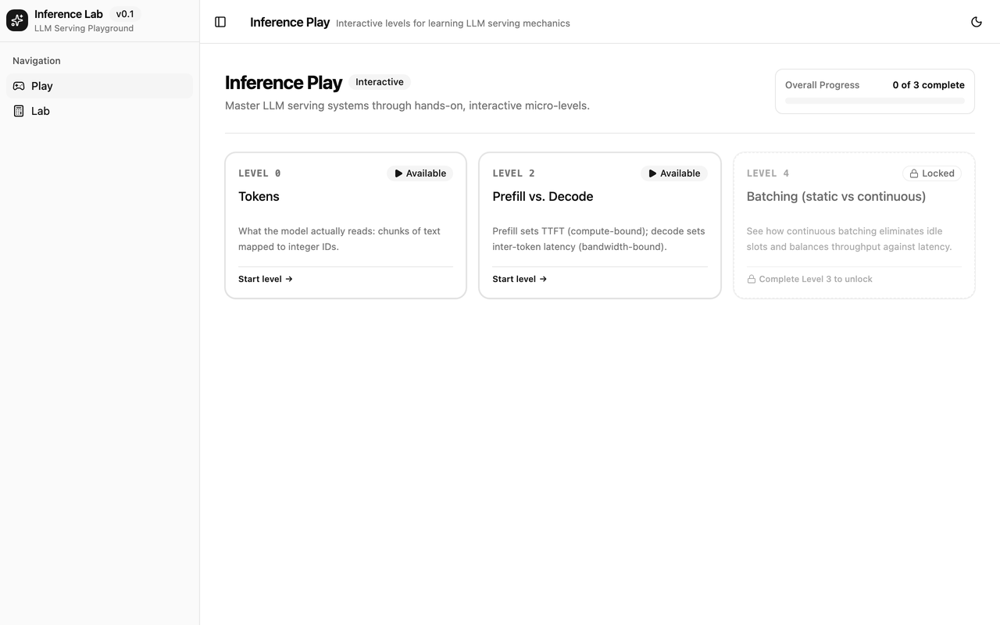
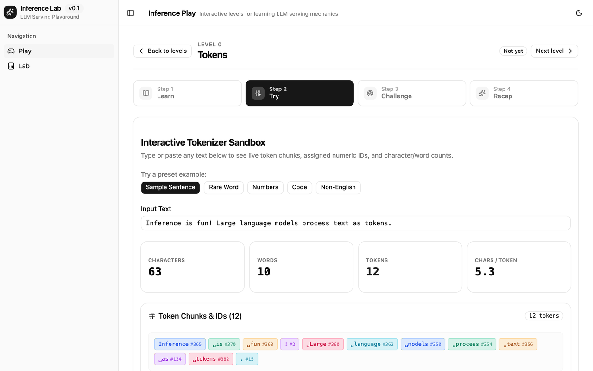
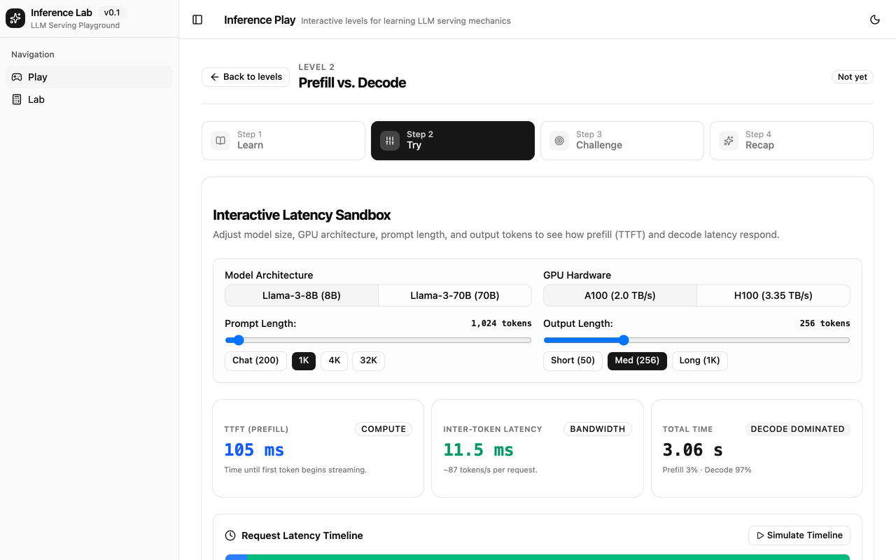
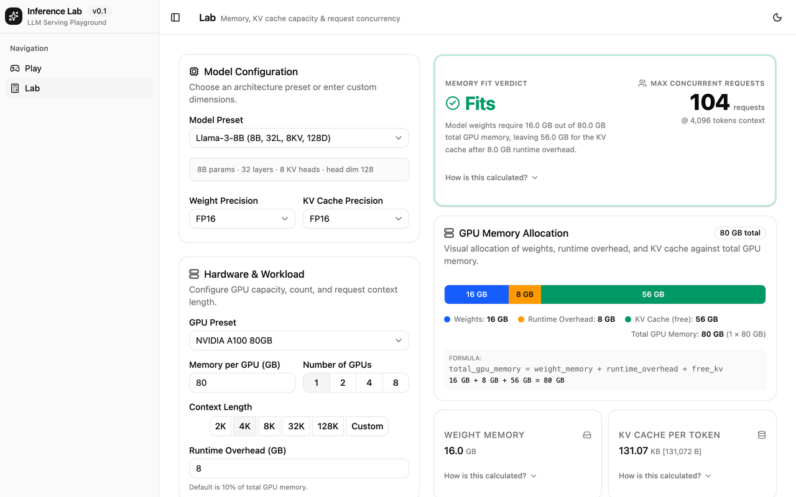
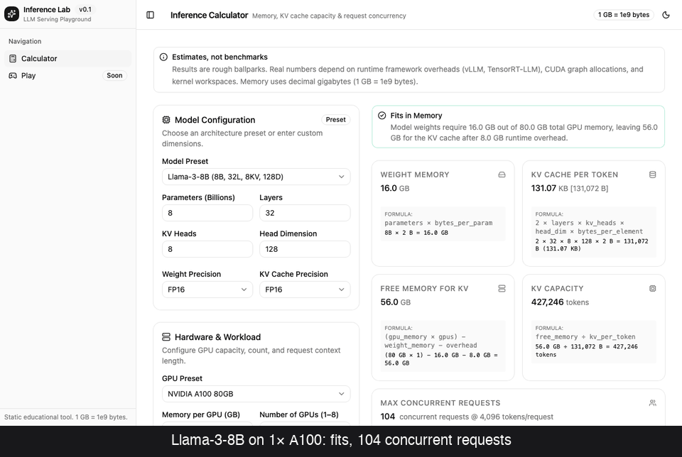

# Inference Lab

Learn how LLM inference works by playing with it. Short levels build your intuition one concept at a time. The Lab lets you plug in any model and GPU to check the numbers yourself.



It runs entirely in the browser: no backend, no API keys, no network calls.

## What's inside

### Play

Each level teaches one building block of inference serving, in four steps:

1. **Learn**: a few sentences and one diagram.
2. **Try**: a sandbox with live numbers.
3. **Challenge**: hit a target to finish the level.
4. **Recap**: the takeaways in three bullets.

| Level | Concept | The intuition you should leave with |
|---|---|---|
| 0 | Tokens | Models read and write tokens, not words. Cost, speed and memory all scale with token count. |
| 1 | Sampling | Temperature and top-p change which next token gets picked. |
| 2 | Prefill vs decode | Reading the prompt is fast and parallel. Generating is one token at a time, limited by memory bandwidth. |
| 3 | KV cache | Memory grows with context length × concurrent requests, not just model size. |
| 4 | Batching | Serving many requests together is where throughput comes from, until memory runs out. |
| 5 | Quantization | Fewer bits per weight means fewer GPUs, at some cost in quality. |

Levels unlock in order, and your progress is saved in the browser.

| Play home | Level 0: Tokens |
|---|---|
|  |  |

### Lab

Pick a model, precision, GPU and context length. The Lab tells you whether the model fits and how many requests you can serve at once. Every number has a "How is this calculated?" toggle showing the formula with your values plugged in.

| Level 2: Prefill vs decode | Lab |
|---|---|
|  |  |

## How to

### Run it locally

You need Node 22+.

```bash
npm ci
npm run dev       # http://localhost:5173
```

To build the static site: `npm run build`, then `npm run preview` to serve `dist/`. The build uses relative paths, so `dist/` works from any static host or sub-path.

### Play a level

1. Open **Play** (the home screen) and pick the first unlocked level.
2. Read **Learn**, then open **Try** and move the controls until the numbers make sense.
3. Open **Challenge** and meet the goal. The level is marked complete and the next one unlocks.
4. **Back to levels** shows your overall progress. **Reset progress** starts over.

### Answer "will this model fit?" in the Lab

1. Open **Lab** from the sidebar.
2. Choose a **Model preset** (for example Llama-3-70B) and a **GPU preset** (for example A100 80GB).
3. The verdict card says **Fits** or **Does not fit**, and the memory bar shows weights, overhead and free KV cache.
4. If it doesn't fit, try more GPUs (1/2/4/8) or a smaller **Weight precision** such as INT4.
5. To see how context length affects concurrency, change **Context length** and watch **Max concurrent requests**.

A few to try:

| Setup | What you'll see |
|---|---|
| Llama-3-8B, FP16, 1× A100 80GB, 4K context | Fits, with about 104 concurrent requests |
| Llama-3-70B, FP16, 1× A100 80GB | 140 GB of weights: does not fit |
| Llama-3-70B, FP16, 2× A100 80GB | Fits again |
| Llama-3-70B, INT4, 1× A100 80GB | Fits on one GPU |

### Use a custom model

Choose **Custom** in the model preset list. Enter parameters, layers, KV heads and head dimension; the numbers usually come from the model's `config.json` (`num_hidden_layers`, `num_key_value_heads`, `hidden_size / num_attention_heads`).

### Check the math

All formulas live in [`src/lib/model.ts`](src/lib/model.ts), with tests in `src/lib/model.test.ts`. Sanity checks: 70B parameters at FP16 is 140 GB of weights, and Llama-3-8B uses 131,072 bytes of KV cache per token at FP16. Memory uses decimal units (1 GB = 10⁹ bytes).

These are estimates for learning, not benchmarks. Real numbers depend on the serving framework, kernels and interconnect.

## How it was built

Every line of app code was written by [Fullsend](https://fullsend.sh) agents during the ADLC Day of Learning. A human wrote the issues and [`AGENTS.md`](AGENTS.md), then orchestrated: starting runs, merging approved PRs, and asking for fixes when PRs conflicted.

- **Triage** read each issue, checked for missing information and flagged dependencies ("blocked by #20").
- **Code** implemented each issue and opened a PR.
- **Review** reviewed every PR for correctness, accessibility and the rules in `AGENTS.md`.
- **Fix** addressed review findings and resolved merge conflicts.
- **Retro** looked back at merged PRs and filed follow-up issues, which became several of the rules in `AGENTS.md`.

By the end of the day there were about 190 agent runs and about 1 billion tokens (mostly cache reads), all running on Gemini Flash.

**Before → after.** The first version was a single calculator form:



## Development

```bash
npm run lint
npm run typecheck
npm test
npm run build
```

CI runs all four on every pull request. See [`AGENTS.md`](AGENTS.md) for the stack (Vite, React, TypeScript, shadcn/ui with Base UI, Tailwind v4, Vitest) and the rules for contributors, human or agent.
